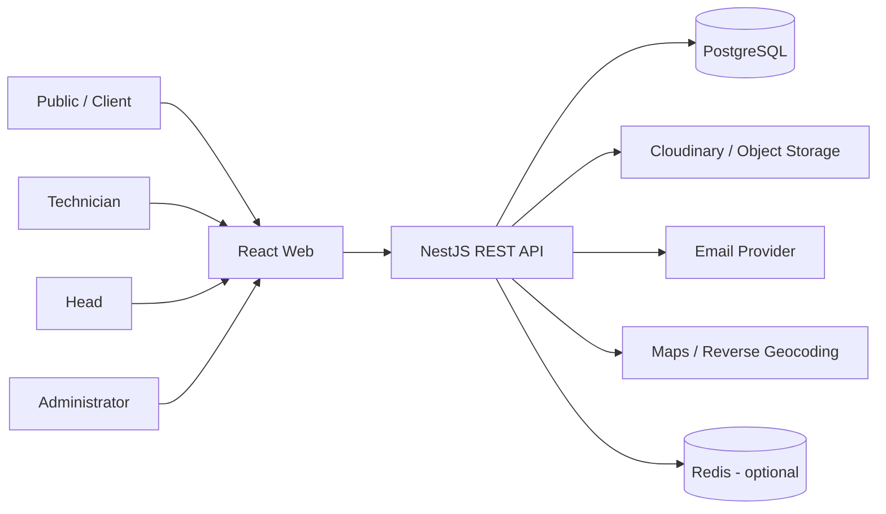

# Arsitektur Sistem

## 1. Gaya Arsitektur

Gunakan **modular monolith**. Semua domain berada dalam satu aplikasi NestJS, tetapi dipisahkan melalui module, provider, repository, dan kontrak yang jelas.

Alasan:

- domain masih berada pada satu bounded operational context;
- transaksi ticket, assignment, dan SLA membutuhkan konsistensi database;
- deployment lebih sederhana untuk MVP;
- modularitas tetap mendukung pemisahan service di masa depan bila terbukti diperlukan.

## 2. Diagram Konteks

## 3. Komponen Utama

### Frontend

- React + Vite + TypeScript.
- TanStack Query untuk server state.
- React Router untuk routing.
- Form library dan schema validation.
- Tailwind CSS untuk UI.

### Backend

- NestJS REST API.
- Global ValidationPipe.
- JWT authentication.
- Permission guard.
- Prisma repository/data access.
- Scheduler untuk evaluasi SLA dan notification sederhana.
- BullMQ/Redis hanya saat background job diperlukan.
- Swagger/OpenAPI sebagai kontrak API.

### Database

- PostgreSQL.
- Prisma schema dan migration SQL versioned.
- Foreign key dan unique constraint wajib.
- Transaksi pada response pertama, assignment, transition, dan closure.

### Media

- Private asset atau authenticated delivery.
- Metadata disimpan di database; binary tidak disimpan di PostgreSQL.
- Direct signed upload disarankan untuk video besar.

## 4. Module Backend

| Module | Tanggung jawab |
|---|---|
| `auth` | Login, refresh, logout, password reset |
| `users` | User lifecycle dan status akun |
| `access-control` | Role, permission, guards, policy |
| `technicians` | Profile, registration, approval |
| `clients` | Client/customer master |
| `sites` | Lokasi, koordinat target, QR code |
| `ticket-catalog` | Category, priority, SLA policy |
| `tickets` | Create, read, response, status, comments |
| `assignments` | Assignment, member, lead, reassignment |
| `field-operations` | Check-in, work activity, completion |
| `sla` | SLA instance, calculation, warning, breach |
| `media` | Signature, metadata, access policy |
| `notifications` | In-app/email notification |
| `reports` | Query report, summary, Excel export |
| `audit` | Audit event dan viewer |
| `health` | Liveness, readiness, dependency check |

## 5. Dependency Rule

- Controller hanya menangani HTTP mapping.
- Service mengorkestrasi use case.
- Domain policy/state machine memvalidasi business rule.
- Repository/data access membungkus Prisma query kompleks.
- Module tidak boleh mengakses tabel module lain secara sembarang; gunakan exported service atau query service yang disetujui.
- Hindari circular dependency. Jangan menggunakan `forwardRef` sebagai solusi default.

## 6. Alur Transactional Kritis

### First Response

Dalam satu database transaction:

1. lock/read ticket;
2. pastikan role dan state valid;
3. simpan response;
4. set `first_responded_at` hanya jika masih kosong;
5. selesaikan SLA Respond instance;
6. buat status log dan audit event;
7. buat outbox/notification event bila digunakan.

### Assignment

Dalam satu transaction:

1. validasi ticket dan teknisi aktif;
2. buat assignment batch;
3. buat member dan tentukan satu lead;
4. snapshot SLA policy;
5. buat SLA Pengerjaan per member;
6. transisi ticket;
7. buat status log dan audit event.

### Technician Completion

Dalam satu transaction:

1. validasi actor adalah member aktif;
2. simpan work summary/media metadata;
3. set member `completed_at` idempotently;
4. selesaikan SLA Pengerjaan member;
5. hitung apakah syarat ticket resolution telah terpenuhi;
6. buat timeline dan notification.

## 7. Time dan Timezone

- Database menyimpan UTC.
- API mengirim ISO-8601 dengan offset/UTC.
- Frontend menampilkan WITA.
- Formula SLA menggunakan waktu server.
- Device time hanya metadata diagnostik.

## 8. Konsistensi dan Idempotency

Endpoint berikut harus idempotent atau memiliki proteksi duplikasi:

- create public ticket;
- first response;
- assignment;
- check-in;
- technician completion;
- close/reopen;
- notification generation;
- export request.

Gunakan idempotency key pada public create dan upload finalization bila diperlukan. Gunakan unique constraint untuk event satu kali.

## 9. Evolusi Arsitektur

Microservice hanya dipertimbangkan jika terdapat bukti kebutuhan, misalnya:

- volume notification/export mengganggu API;
- kebutuhan scaling independen;
- ownership tim terpisah;
- boundary transaksi sudah stabil.

Kandidat pertama untuk dipisahkan adalah notification worker atau reporting/export worker, bukan ticket core.
