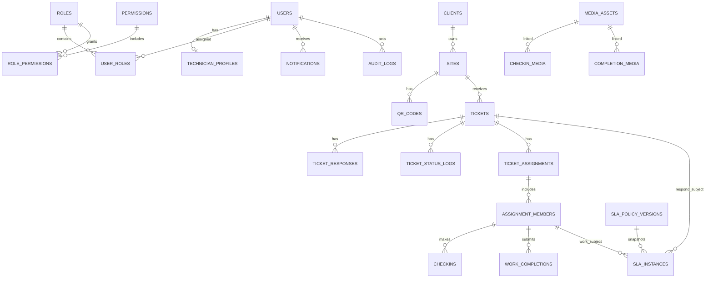

# Model Data dan Data Dictionary

## 1. Prinsip

- Gunakan UUID internal untuk primary key.
- Ticket code merupakan public identifier terpisah.
- Semua timestamp menggunakan UTC.
- Gunakan foreign key, unique constraint, dan check constraint bila didukung.
- Soft delete hanya untuk master data yang perlu histori; transaksi tidak dihapus.
- Event penting bersifat append-oriented.

## 2. Diagram Relasi Ringkas

## 3. Identity dan Access

### `users`

| Field | Catatan |
|---|---|
| `id` | UUID |
| `email` | unique, normalized |
| `phone_normalized` | optional unique sesuai policy |
| `password_hash` | tidak pernah dikembalikan |
| `display_name` | nama pengguna |
| `status` | account lifecycle |
| `must_change_password` | fallback reset |
| `last_login_at` | audit dasar |
| `created_at`, `updated_at` | UTC |

### `roles`, `permissions`, `user_roles`, `role_permissions`

Mendukung permission-based authorization. Hindari hardcode seluruh kewenangan hanya dari nama role.

### `refresh_tokens`

Simpan token hash, device/session metadata, expiry, revoked_at, dan rotation lineage.

### `password_reset_tokens`

Token hash, expiry, used_at, requested_ip, dan user_id.

## 4. Technician

### `technician_profiles`

- `user_id`;
- employee/code optional;
- skills optional;
- approval status;
- approved_by;
- approved_at;
- rejection_reason;
- active availability flag.

### `technician_approval_logs`

Histori keputusan approval, reviewer, note, dan timestamp.

## 5. Client, Site, dan QR

### `clients`

- nama client;
- code;
- status;
- contact metadata.

### `sites`

- client_id;
- nama site;
- alamat;
- latitude/longitude target;
- allowed check-in radius optional;
- timezone default WITA;
- status.

### `qr_codes`

- site_id;
- opaque public token;
- status;
- expired_at optional;
- created_by.

## 6. Ticket Catalog

### `ticket_categories`

Master kategori, aktif/nonaktif, urutan tampilan.

### `ticket_priorities`

`CRITICAL`, `HIGH`, `MEDIUM`, `LOW`, label, severity order.

### `sla_policy_versions`

- version number;
- priority;
- respond target seconds;
- work target seconds;
- warning threshold;
- calculation mode;
- effective_from;
- created_by;
- immutable setelah digunakan.

## 7. Ticket

### `tickets`

| Field | Catatan |
|---|---|
| `id` | UUID internal |
| `ticket_code` | unique public code |
| `site_id` | asal QR/site |
| `reporter_name` | pelapor |
| `pic_name` | PIC |
| `contact_phone_normalized` | pencocokan tracking |
| `contact_phone_masked` | dapat dihitung, tidak wajib disimpan |
| `category_id` | nullable sebelum triage jika perlu |
| `priority_id` | snapshot/current priority |
| `description` | keluhan |
| `status` | state machine |
| `service_cycle_no` | mulai dari 1 |
| `first_responded_at` | immutable setelah terisi |
| `resolved_at` | current/last cycle |
| `closed_at` | current/last cycle |
| `created_at`, `updated_at` | UTC |

### `ticket_responses`

- type (`OFFICIAL_INITIAL_RESPONSE`, `FOLLOW_UP`, `PUBLIC_UPDATE`);
- message;
- created_by;
- created_at;
- edited_at optional;
- original response tetap dipertahankan untuk audit bila diedit.

### `ticket_status_logs`

- from_status;
- to_status;
- actor_id;
- reason;
- metadata JSON terbatas;
- created_at.

### `ticket_comments`

Pisahkan komentar internal dan public update.

## 8. Assignment

### `ticket_assignments`

- ticket_id;
- service_cycle_no;
- assigned_by;
- assigned_at;
- status;
- note;
- ended_at.

### `assignment_members`

| Field | Catatan |
|---|---|
| `assignment_id` | parent assignment |
| `technician_id` | user technician |
| `is_lead` | satu true per assignment aktif |
| `required_for_resolution` | menentukan closure requirement |
| `status` | member workflow |
| `assigned_at` | start SLA baseline |
| `accepted_at`, `rejected_at` | optional workflow |
| `first_checkin_at` | KPI onsite |
| `work_started_at` | optional explicit start |
| `completed_at` | stop SLA Pengerjaan |
| `ended_at` | reassigned/removed |
| `completion_summary` | ringkasan individual |

Constraint penting:

- unique active technician per assignment;
- satu lead aktif;
- completed_at tidak boleh sebelum assigned_at.

## 9. Field Operation

### `checkins`

- assignment_member_id;
- latitude;
- longitude;
- accuracy_meters;
- device_captured_at;
- server_received_at;
- address_snapshot;
- distance_from_site_meters;
- source;
- notes.

### `work_completions`

- assignment_member_id;
- summary;
- completed_at server;
- location optional;
- submitted_by.

## 10. Media

### `media_assets`

- provider;
- provider_public_id;
- resource_type;
- MIME type;
- extension;
- size_bytes;
- width/height/duration;
- checksum optional;
- access classification;
- uploaded_by;
- created_at.

Join table atau polymorphic reference menghubungkan media ke complaint, check-in, dan completion. Hindari polymorphic relation tanpa constraint bila desain join table lebih aman.

## 11. SLA

### `sla_instances`

Field minimum sesuai `SLA-Specification.md`. Gunakan unique constraint:

- satu SLA Respond per ticket/cycle policy;
- satu SLA Work per assignment member.

### `sla_events`

Append-only event: started, warning, breached, completed, ended, recalculated.

## 12. Notification dan Audit

### `notifications`

- recipient_user_id;
- type;
- title/body;
- related entity;
- unique_event_key;
- read_at;
- created_at.

### `audit_logs`

- actor_user_id nullable untuk public/system;
- action;
- resource_type/id;
- before JSON terbatas;
- after JSON terbatas;
- ip/user-agent/request-id;
- created_at.

Jangan menyimpan password, token, atau binary media dalam audit JSON.

## 13. Index Minimum

- `tickets(ticket_code)` unique;
- `tickets(status, created_at)`;
- `tickets(site_id, created_at)`;
- `assignment_members(technician_id, status)`;
- `sla_instances(status, due_at)`;
- `notifications(recipient_user_id, read_at, created_at)`;
- `audit_logs(resource_type, resource_id, created_at)`;
- normalized phone lookup sesuai kebutuhan tracking.

## 14. Retention

Retention harus disetujui bisnis. Baseline:

- ticket dan audit: minimal sesuai kebijakan organisasi;
- password reset token: hapus/anonymize setelah periode pendek;
- refresh token revoked: simpan terbatas untuk security review;
- media: mengikuti umur ticket dan kebijakan privasi.
