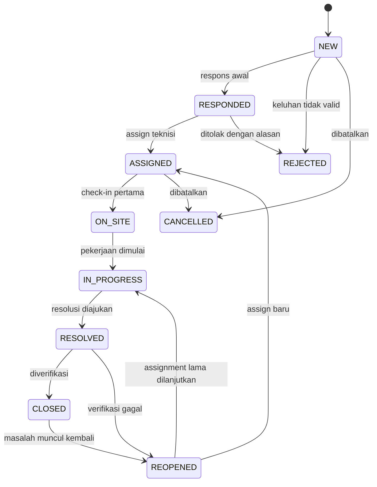

# Workflow dan State Machine Ticket

## 1. Status Internal

```text
NEW
RESPONDED
ASSIGNED
ON_SITE
IN_PROGRESS
RESOLVED
CLOSED
REJECTED
REOPENED
CANCELLED
```

`REOPENED` dapat dipakai sebagai event/status transisi dan kemudian dilanjutkan ke `ASSIGNED` atau `IN_PROGRESS`, sesuai keputusan implementasi. Untuk database sederhana, simpan status `REOPENED` agar laporan dapat melihat ticket aktif kembali.

## 2. Status Publik

| Internal | Public label |
|---|---|
| `NEW` | Dalam Antrian |
| `RESPONDED` | Sudah Direspons |
| `ASSIGNED` | Teknisi Ditugaskan |
| `ON_SITE`, `IN_PROGRESS`, `REOPENED` | Sedang Dikerjakan |
| `RESOLVED` | Menunggu Verifikasi |
| `CLOSED` | Selesai |
| `REJECTED` | Ditolak |
| `CANCELLED` | Dibatalkan |

## 3. Diagram State



## 4. Transition Matrix

| Dari | Ke | Actor | Field wajib | Side effect |
|---|---|---|---|---|
| `NEW` | `RESPONDED` | Admin/Head | response message, priority | Stop SLA Respond |
| `NEW` | `REJECTED` | Admin/Head | rejection reason | Stop SLA Respond dengan outcome rejected |
| `RESPONDED` | `ASSIGNED` | Admin/Head | technician members, lead | Buat SLA Pengerjaan per teknisi |
| `ASSIGNED` | `ON_SITE` | Assigned Technician | location, photo | Simpan check-in |
| `ON_SITE` | `IN_PROGRESS` | Assigned Technician | start note opsional | Simpan work start |
| `IN_PROGRESS` | `RESOLVED` | Lead/Admin/Head | resolution summary, evidence | Validasi completion requirement |
| `RESOLVED` | `CLOSED` | Admin/Head | verification note | Final closure |
| `RESOLVED/CLOSED` | `REOPENED` | Admin/Head | reopen reason | Buat histori dan evaluasi assignment baru |
| Aktif | `CANCELLED` | Admin/Head | cancellation reason | Stop instance aktif sesuai outcome |

## 5. Respons Awal

- Hanya respons bertipe `OFFICIAL_INITIAL_RESPONSE` yang menghentikan SLA Respond.
- Komentar internal tidak dihitung sebagai respons.
- Assignment tidak dihitung sebagai respons bila response message belum dibuat.
- Timestamp pertama bersifat immutable.

## 6. Multiple Technician

Setiap assignment memiliki:

- satu `lead_technician_id`;
- satu atau lebih assignment member;
- status per member;
- SLA Pengerjaan per member.

Status member:

```text
ASSIGNED
ACCEPTED
REJECTED
ON_SITE
IN_PROGRESS
COMPLETED
REMOVED
REASSIGNED
```

Aturan:

- Hanya satu lead aktif.
- Completion teknisi A tidak menyelesaikan SLA teknisi B.
- Head/Admin dapat menandai member sebagai tidak diwajibkan untuk closure, tetapi perubahan harus diaudit.
- Ticket dapat menjadi `RESOLVED` ketika seluruh `required_for_resolution` member telah `COMPLETED`, atau Head/Admin melakukan override dengan alasan.

## 7. Reassignment

Reassignment tidak menghapus assignment lama.

- Member lama mendapat `ended_at` dan outcome `REASSIGNED` atau `REMOVED`.
- SLA instance lama dihentikan dan dipertahankan untuk report.
- Member baru mendapat assignment dan SLA instance baru.
- Ticket timeline mencatat actor dan alasan.

## 8. Reopen

Saat ticket dibuka kembali:

- alasan wajib;
- status closure/resolution lama tetap dalam histori;
- sistem menentukan apakah assignment lama dilanjutkan atau assignment baru dibuat;
- SLA Respond awal tidak dimulai ulang;
- SLA Pengerjaan baru dibuat untuk assignment baru;
- report membedakan cycle pertama dan reopen cycle.

## 9. Rejection dan Cancellation

- `REJECTED`: keluhan dinilai tidak valid/tidak masuk scope sebelum pengerjaan.
- `CANCELLED`: ticket valid tetapi dihentikan karena alasan operasional.
- Keduanya wajib memiliki alasan dan actor.

## 10. Error Rule

Transition invalid mengembalikan `409 CONFLICT` dengan error code stabil, misalnya:

```json
{
  "error": {
    "code": "INVALID_TICKET_TRANSITION",
    "message": "Ticket tidak dapat berpindah dari CLOSED ke ASSIGNED.",
    "details": {
      "from": "CLOSED",
      "to": "ASSIGNED"
    }
  }
}
```
